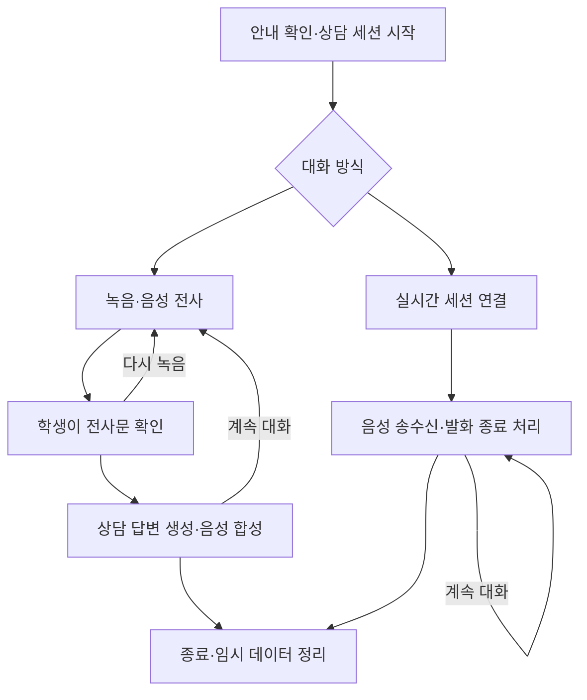

# SAFE-PATH 백엔드 — AI 익명 음성 상담

2026-11-13 기준 팀 논의용 구현 계획과 현재 공통 백엔드 실행 방법을 정리한다.
SAFE-PATH를 유력 주제로 두고 학생의 AI 사전 상담을 검토 중이며, 최종 기능 범위와 실제 운영 절차는 예비교사·프론트엔드 담당자와 협의한다.

## 1. 목표와 현재 구현 상태

학생이 이름을 입력하지 않고 말로 고민을 이야기하고, AI가 공감하며 상황을 정리해 필요한 도움을 선택하도록 지원하는 상담 입구를 만든다.
AI의 역할은 공감, 안전 확인, 상황 정리, 사람의 도움을 받을 방법 안내로 한정한다.
학생에게 AI와 대화한다는 사실과 녹음·전사문·외부 AI 전송·교사 전달 조건을 안내한다.

| 항목 | 현재 상태 |
| --- | --- |
| Python 3.10 이상·FastAPI 공통 구조 | 구현됨 |
| `GET /health`, `POST /api/ai/generate` | 구현됨 |
| `.env` 로딩·키의 Git 제외·텍스트 모의 응답 | 구현됨 |
| OpenAI Chat Completions 호환 텍스트 어댑터 | 구현됨. BAZE 인증·경로·실제 호출은 미검증 |
| 익명 상담 세션·대화 이력 분리 | 설계 초안 |
| 녹음·STT·전사문 수정·TTS | 설계 초안 |
| 실시간 음성 세션·끼어들기·재연결 | 설계 초안 |
| 고품질형·가성비형 프리셋 선택 | 설계 초안 |
| 슈퍼스쿨 상담 예약·상담카드 연동 | 기능 조사 완료 범위가 있으며 API 연동은 미확인 |
| 실제 상담·학교폭력 신고·교사 전달 운영 절차 | 팀 협의 필요 |

현재 모의 응답은 연결 확인 문장이다. 음성 입력이나 상담 대화를 시연하려면 아래 계획의 기능을 추가해야 한다.
현재 API 키와 모델명은 입력 전이며, 코드의 `baze_configured`는 필수 설정 입력 여부를 뜻한다.

## 2. 비교할 두 가지 대화 방식

| 비교 항목 | 녹음형 — STT → 상담 모델 → TTS | 실시간형 — 음성 모델 세션 |
| --- | --- | --- |
| 학생 경험 | 녹음을 끝낸 뒤 답변을 받음 | 통화처럼 말을 주고받음 |
| 기본 입력 | 버튼으로 녹음 시작·종료 | 마이크 스트림과 발화 종료 감지 또는 수동 발화 종료 |
| 응답 지연 | 업로드·전사·상담 생성·합성 시간이 누적 | 낮은 첫 음성 지연을 목표로 연속 송수신 |
| 발언 확인 | 상담 모델에 보내기 전 전사문 수정 가능 | 즉시 응답과 사전 확인을 함께 제공할지 별도 설계 |
| 모델 교체 | STT·상담·TTS를 각각 교체 | 세션의 실시간 음성 모델을 교체 |
| 개발 부담 | 단계별 API·파일·오류 처리 | 연결 수립·음성 이벤트·중단·재연결 처리 |
| 원인 분석 | 전사·상담·합성 중 실패 단계 식별 | 모델 응답과 연결·재생 상태를 함께 추적 |
| 비용 측정 | STT·상담·TTS 사용량을 합산 | 실시간 세션의 음성·텍스트 사용량을 측정 |
| 시연 중 확인할 점 | 답변 대기 시간과 단계별 실패 복구 | 끼어들기·망설임·소음·연결 끊김 대응 |

실시간형은 음성 이해·추론·음성 응답을 한 세션에서 다룬다.
녹음형은 단계 사이의 텍스트를 검사·수정하고 구성 요소를 독립적으로 교체하기 쉽다.
녹음형도 향후 스트리밍을 추가할 수 있으며, 실시간형도 수동 발화 종료를 사용할 수 있다.
두 방식의 지연 시간과 전체 비용은 학교 게이트웨이에서 동일한 사례로 측정한다.
[음성 에이전트 구조](https://developers.openai.com/api/docs/guides/voice-agents), [실시간 API](https://developers.openai.com/api/docs/guides/realtime)

다음은 계획상 사용자 흐름이다.



## 3. 방식 A — 녹음형 구현 계획

### 학생 이용 흐름

1. AI 상담 안내와 데이터 처리 범위를 확인하고 익명 세션을 시작한다.
2. 마이크 권한을 허용하고 버튼을 눌러 한 번의 발언을 녹음한다.
3. 녹음을 종료하면 백엔드가 STT를 요청한다.
4. 학생에게 전사문을 보여준다. 인식 오류를 고치거나 재녹음할 수 있다.
5. 학생이 확인한 문장과 같은 세션의 이전 대화를 상담 모델에 전달한다.
6. 답변 텍스트를 표시하고, 학생이 듣기를 선택하면 합성 음성을 재생한다.
7. 추가 대화를 하거나 종료한다. 사람의 도움 요청 경로는 대화 중에도 접근할 수 있게 한다.

실명 등 식별 정보는 말하기 전 안내하고, 전사문에서도 학생이 수정할 기회를 제공한다.
전사문 확인은 외부 STT 처리 이후에 이뤄지므로, STT 제공사로 원음이 전달되는 사실도 안내해야 한다.

### 백엔드 구성

| 구성 | 책임 |
| --- | --- |
| 세션 관리 | 임의의 세션 접근 자격 발급, 만료·종료, 세션별 대화 분리 |
| 녹음 수신 | 크기·형식·녹음 길이 검증, 취소·실패 시 임시 파일 정리 |
| STT 어댑터 | 학교 경로로 녹음 전달, 완료 대기·조회 방식 처리, 전사문 반환 |
| 상담 서비스 | 서버의 상담 지침과 확인된 대화 문맥을 모델에 전달 |
| TTS 어댑터 | 생성된 답변을 합성하고 재생용 응답 반환 |
| 오류 처리 | 단계별 재시도와 텍스트 사용 경로 제공 |

학교 제공 STT 후보는 `stt-async-v6`다.
Soniox 원 서비스는 파일 전사 작업을 비동기로 처리하며 결과 조회나 웹훅을 지원한다.
학교 게이트웨이가 이 과정을 동기 응답으로 감싸는지, 작업 ID를 반환하는지는 호출 예제로 확인한다.
[Soniox 파일 전사](https://docs.soniox.com/stt/async/async-transcription)

### 장점과 구현 시 고려 사항

- 전사문을 상담 모델에 보내기 전에 학생이 확인할 수 있다.
- 같은 입력·문맥·상담 지침으로 상담 모델만 교체하여 비교하기 쉽다.
- STT·상담·TTS의 지연과 오류를 각각 측정할 수 있다.
- 여러 단계의 대기 시간이 누적된다. 인식 오류와 답변 지연을 줄이는 작업이 필요하다.
- 목소리의 억양 등 텍스트에 남지 않는 정보는 텍스트 상담 모델 입력에 포함되지 않는다.
- 같은 발언을 중복 전송했을 때 모델 호출과 비용이 반복되지 않도록 요청 ID를 관리한다.

## 4. 방식 B — 실시간형 구현 계획

### 학생 이용 흐름

1. 익명 상담 세션을 만들고 데이터 처리 안내를 확인한다.
2. 백엔드가 학교 게이트웨이에 실시간 세션 생성을 요청한다.
3. 확인된 연결 규격에 따라 브라우저가 단기 자격으로 연결하거나 백엔드를 통해 음성을 전달한다.
4. 학생의 발화를 전달하고 AI 음성을 수신·재생한다.
5. 발화 종료, 잠깐의 침묵, 학생의 끼어들기를 처리한다.
6. 종료 시 마이크 트랙, 재생 버퍼, 연결 및 관련 임시 데이터를 정리한다.

### 연결 방식에서 확인할 사항

| 확인 항목 | 구현에 필요한 정보 |
| --- | --- |
| 세션 생성 | 필수 필드, 모델 ID, 세션 수명, 생성 실패 응답 |
| 연결 수단 | WebRTC·WebSocket 등 실제 지원 방식과 접속 주소 |
| 브라우저 인증 | 단기 자격 발급 여부, 만료·갱신 규칙 |
| 서버 경유 | 백엔드 중계 연결을 지원하는지와 별도 인증 방식 |
| 오디오 | 코덱·샘플레이트·프레임 규격과 지원 음성 |
| 대화 이벤트 | 발화 시작·종료, 답변 시작·종료, 취소·중단 이벤트 |
| 전사 | 입력·출력 전사문 제공 여부와 실제 발화와의 대응 |
| 비용 | 음성·텍스트 계량 방식, 무음 처리, 세션 제한 |
| 데이터 | 제공사 보관·삭제·모델 개선 이용 정책 |

학교에서 제공된 생성 경로는 `POST /realtime/sessions/`다.
OpenAI 원 API 문서는 브라우저 WebRTC와 서버 WebSocket, 단기 자격 발급 등의 구성을 설명하지만, 학교 게이트웨이의 실제 지원 범위는 별도 확인해야 한다.
학교의 장기 API 키는 백엔드 환경변수에서 사용한다.
[실시간 연결 가이드](https://developers.openai.com/api/docs/guides/realtime)

### 상담에 맞춘 발화 처리

- 학생이 생각하거나 망설이는 시간을 고려해 발화 종료 감지 설정을 시험한다.
- 자동 감지와 수동 발화 종료 중 초기 시연 방식을 선택한다.
- AI가 말하는 중 학생이 다시 말하면 재생 중단과 서버 응답 취소를 함께 처리한다.
- 끊긴 연결을 새로 만들 때 전달할 대화 문맥과 학생에게 표시할 안내를 정한다.
- 마이크 상태와 연결 상태를 화면에 표시하고, 학생이 즉시 음소거·종료할 수 있게 한다.

OpenAI 원 API는 침묵 기반과 의미 기반 발화 종료 감지를 제공하며 자동 감지를 끌 수도 있다.
해당 옵션이 학교 게이트웨이에서도 노출되는지는 확인 대상이다.
[발화 감지 설정](https://developers.openai.com/api/docs/guides/realtime-vad)

### 장점과 구현 시 고려 사항

- 낮은 응답 지연과 자연스러운 차례 주고받기를 목표로 할 수 있다.
- 실시간 모델의 음성 입출력을 한 세션에서 사용할 수 있다.
- 끼어들기·재연결·음성 버퍼 처리의 구현 및 통합 테스트가 필요하다.
- 즉시 말하는 답변에 검토 단계를 추가하면 대화 속도에 영향을 준다.
- 자연스러운 말투와 상담 응답의 적절성은 각각 평가한다.

## 5. 고품질형·가성비형 모델 비교 계획

아래는 비교용 후보이며 한국어 학교폭력 상담에 대한 실증 순위가 아니다.
학교가 제공한 전체 목록은 [BAZE_MODEL_CATALOG.md](docs/BAZE_MODEL_CATALOG.md)에 있다.

| 대화 방식 | 프리셋 | STT | 상담·실시간 모델 | TTS |
| --- | --- | --- | --- | --- |
| 녹음형 | `quality` | `stt-async-v6` | `claude-opus-5-5` | `gemini-3.8-flash-tts` |
| 녹음형 | `economy` | `stt-async-v6` | `gpt-6-luna` | `gemini-3.8-flash-tts` |
| 실시간형 | `quality` | 실시간 모델의 음성 입력 | `gpt-realtime-2.1` | 실시간 모델의 음성 출력 |
| 실시간형 | `economy` | 실시간 모델의 음성 입력 | `gpt-realtime-2.1-mini` | 실시간 모델의 음성 출력 |

- 녹음형의 첫 비교에서는 STT와 TTS를 고정해 상담 모델의 차이를 확인한다.
- 프리셋은 새 상담을 시작할 때 선택하고 해당 세션 동안 유지하는 안을 제안한다.
- 사용할 모델 ID는 백엔드의 허용된 설정으로 매핑한다.
- 학교의 모델별 사용 권한과 차감 요율을 확인하고 실제 비용을 기록한다.
- 실시간형은 단일 음성 모델이므로 녹음형과 비교할 때 구조와 모델 구성의 차이를 함께 고려한다.
- Gemini Live 계열은 학교 연결 규격 확인 후 추가 비교 후보로 검토할 수 있다.

## 6. 현재 설정과 향후 설정의 구분

현재 코드에서 `AI_MODE`는 모의 응답과 BAZE 텍스트 호출을 선택한다.
대화 방식과 프리셋을 선택하는 기능은 이후 구현할 예정이다.

| 구분 | 값 또는 설정 | 상태 |
| --- | --- | --- |
| 현재 실행 모드 | `AI_MODE=mock` 또는 `AI_MODE=baze` | 구현됨 |
| 현재 텍스트 모델 | `BAZE_MODEL` | 구현됨 |
| 대화 방식 | `recorded` 또는 `realtime` | 설계 초안 |
| 모델 프리셋 | `quality` 또는 `economy` | 설계 초안 |
| STT·TTS·실시간 모델별 설정 | 이름과 API 계약을 팀 협의 후 확정 | 설계 초안 |

프리셋과 대화 방식의 선택은 기존 `AI_MODE`와 구분하여 구현한다.
상담 시스템 지침과 모델별 어댑터도 별도로 관리할 계획이다.

## 7. 상담 세션과 데이터 처리 계획

### 익명 세션과 접근

- 상담 시작에 이름·학번·얼굴 인증을 요구하지 않는 안으로 설계한다.
- 세션 식별자와 충분히 예측하기 어려운 접근 자격으로 대화를 구분한다.
- 대화·음성·전사문 조회 시 같은 세션의 접근 자격을 확인한다.
- 발언 순서와 요청 ID를 관리하여 대화 순서 뒤섞임과 중복 외부 호출을 처리한다.
- 만료 시간, 보관 범위, 종료 후 처리 기준은 예비교사와 정한다.
- 종료된 세션에 늦게 도착한 전사·모델 응답은 화면이나 저장 데이터에 다시 붙이지 않는다.

### 음성과 전사문

우리 서버의 원음은 처리에 필요한 동안 임시 사용하고 성공·실패·취소 경로에서 정리하는 안을 제안한다.
공급사로 전송된 음성·텍스트의 보관 범위는 별도 정책으로 확인한다.
학생 이름, 음성, 대화 본문, API 키를 일반 운영 로그에 남기지 않도록 설계한다.

실명 입력을 생략해도 목소리·대화 내용으로 개인을 알아볼 가능성이 있다.
수집 항목, 외부 전송 대상, 보관 기간, 열람자와 교사 전달 조건을 안내한다.
해커톤 시연·평가에는 가상의 인물과 상황을 사용한다.
[음성 등 비정형 데이터의 식별 위험](https://pipc.go.kr/np/cop/bbs/selectBoardArticle.do?bbsId=BS074&mCode=C020010000&nttId=9899)

### 사람의 도움으로 연결

상담 중 도움 요청 버튼을 제공하고, 위험 표현에는 예비교사가 검토한 안내를 제시한다.
교사 전달 전에는 학생에게 전달 내용과 대상, 후속 절차를 설명하는 화면을 제안한다.
생명·안전 및 학교폭력과 관련된 비밀보장 예외와 실제 대응 절차는 담당 교사와 정해 상담 시작 안내에 반영한다.
AI 신호만으로 사람의 지원 여부를 결정하지 않도록 사람에게 도움을 요청하는 경로를 상시 제공한다.
[위(Wee) 상담 이용 안내](https://www.wee.go.kr/fileDownload?bbsId=BOARD00015&fileDownType=C&fileId=X5rKfQm46a&fileSn=1&menuKey=Nkf0nC3AjF)

## 8. 슈퍼스쿨 활용 조사

2026-11-13에 체험 계정의 메뉴와 사용자가 제공한 공개 상담신청 안내서를 확인했다.
계정 정보와 개인 상담 기록은 문서에 포함하지 않는다.
[슈퍼스쿨 상담신청 공식 안내](https://superschoolofficial.notion.site/326e90ac0a99801da465d501c50db881)

| 기능 | 확인 근거 | SAFE-PATH 활용안 |
| --- | --- | --- |
| 개인상담·정기상담 관리 | 체험 메뉴와 공개 안내 | 교사의 후속 상담 일정 관리 |
| 교사 선택·가능 시간 예약 | 공개 안내 | 학생이 원하는 담당자와 상담 시간 선택 |
| 대면·화상·전화 방식 선택 | 공개 안내의 예약 항목 | 후속 상담 채널 선택 |
| 일정·알림 연동 | 공개 안내 | 예약 확정 이후 일정과 안내 관리 |
| 상담카드의 STT 기록 | 공개 안내 | 교사 상담의 기록 업무 지원 |
| 상담 대상·알림 수신 대상 설정 | 공개 안내 | 관련 학생·보호자의 노출 범위 검토 |
| 채팅·슈퍼패스 | 체험 메뉴 | 기능 설명과 연동 범위 추가 확인 |

공개 안내는 상담 당일 `학생정보 > 상담카드`에서 STT 기록을 활용할 수 있다고 설명한다.
전화·화상 항목은 예약 방식 선택으로 확인했으며, 내장 통화 엔진·익명 통화·AI 상담 API 제공 여부는 미확인이다.

### 제안하는 연계 흐름

1. SAFE-PATH에서 학생이 AI 사전 상담을 진행한다.
2. 학생이 사람과의 상담을 원하면 전달 내용과 신원 연결 범위를 확인한다.
3. 초기에는 슈퍼스쿨 상담신청 경로 안내와 교사의 수동 확인으로 시연을 구성할 수 있다.
4. 공식 연동 방법을 확보하면 예약·요약 전달 자동화를 검토한다.
5. 상담카드에 기록할 항목과 열람 권한은 별도로 협의한다.

슈퍼스쿨은 상담 대상자 선택과 알림 수신 대상 설정을 사용한다.
예약 연결 시 학생 신원이 연결될 수 있음을 알리고, 보호자 알림·일정 제목·상담 주제에 노출되는 범위를 확인해야 한다.
자체 STT 기능이 있다는 사실과 외부 시스템이 이를 API로 재사용할 수 있다는 사실은 별도로 검증한다.

### 추가 확인할 연동 정보

- 외부 API·SDK·공식 연동 문서 및 해커톤 계정의 권한.
- 학생·교사 식별자 연결 방식과 익명 세션을 실명 상담으로 전환하는 시점.
- 예약 생성·상담카드 기록 시 열람자와 알림 대상.
- STT 결과 조회·입력, 요약문 전달 또는 파일 가져오기 지원 여부.
- 채팅·전화·화상·슈퍼패스의 실제 제공 범위.

이번 조사에서 확인한 범위는 체험 계정의 메뉴와 공개 안내서다.
개별 학생의 상담 기록, 실제 예약 처리와 외부 API 연동 동작은 미확인이다.

## 9. API 계약 초안 — 향후 구현

이 절의 경로·필드·응답은 팀 논의를 위한 초안이다.
현재 구현된 경로는 12절의 `/health`와 `/api/ai/generate`다.

| 메서드 | 경로 초안 | 책임 |
| --- | --- | --- |
| POST | `/api/counsel/sessions` | 방식·프리셋 선택, 익명 세션과 접근 자격 생성 |
| POST | `/api/counsel/sessions/{id}/transcriptions` | 녹음 전사 요청과 결과 반환 |
| POST | `/api/counsel/sessions/{id}/messages` | 확인한 발언과 문맥으로 상담 답변 생성 |
| POST | `/api/counsel/sessions/{id}/speech` | 해당 세션의 생성된 답변을 음성으로 변환 |
| POST | `/api/counsel/sessions/{id}/realtime` | 실시간 연결에 필요한 단기 자격 또는 중계 정보 준비 |
| DELETE | `/api/counsel/sessions/{id}` | 상담 종료, 접근 자격 만료와 임시 데이터 정리 |

전사 응답은 게이트웨이 규격에 따라 완료 응답 또는 작업 조회 방식 중 하나로 확정한다.
세션 ID만으로 기록을 읽거나 답변 음성을 요청할 수 없도록 접근 검증을 포함한다.
교사에게 자료를 보내거나 예약을 생성하는 계약은 슈퍼스쿨 연동 방식과 운영 절차를 확인한 뒤 별도로 정의한다.

## 10. 역할 분담과 개발 순서

| 담당 | 준비할 내용 |
| --- | --- |
| 백엔드·AI 담당 | 세션, BAZE 어댑터, 모델 선택, 데이터 정리, 오류 처리, 측정 |
| 프론트엔드 담당 | 마이크·녹음 UI, 전사 수정, 대화 표시, 재생·음소거, 상태·종료·도움 요청 |
| 예비교사 담당 | 대상 학년, 상담 사례, 응답 기준, 도움 연계·비밀보장 안내, 시연 평가 |
| 팀 공동 | 슈퍼스쿨 활용 범위, 알림·열람 범위, 최종 시연 흐름 |

| 단계 | 작업 | 통과 기준 |
| --- | --- | --- |
| 1 | 학교 API 규격·키·권한 확인 | 짧은 가상 입력으로 실제 요청과 응답 확인 |
| 2 | 세션·텍스트 상담 기반 | 세션 간 대화 분리, 여러 턴 문맥, 종료 처리 |
| 3A | 녹음형 연결 검증 | 녹음·전사 확인·상담 답변·재생을 한 흐름으로 완료 |
| 3B | 실시간형 연결 검증 | 세션 연결·음성 왕복·발화 종료·연결 정리 확인 |
| 4 | 방식과 프리셋 비교 | 같은 사례로 품질·지연·비용·오류 복구 비교 |
| 5 | 팀의 구현 방식 선택 | 평가 결과와 남은 개발 시간을 보고 결정 |
| 6 | 시연 안정화 | 일반 상담·인식 오류·도움 요청·통신 실패 사례 확인 |

3A와 3B는 짧은 연결 검증을 위한 선택지다. 두 방식을 모두 완성하는 일정은 아직 확정하지 않았다.
기존 녹음형을 먼저 완성하는 안과 실시간형을 핵심 시연으로 삼는 안을 팀이 선택한다.

## 11. 테스트와 팀 논의 항목

### 비교 테스트

가상의 동일 사례·상담 지침·답변 길이 목표를 사용한다.
녹음형의 프리셋 비교에서는 STT·TTS를 고정하고 상담 모델을 변경한다.
실시간형에서는 같은 발화 내용과 발화 간격을 재현하고 전사·음질·대화 타이밍을 함께 확인한다.

| 평가 항목 | 측정·검토 방법 |
| --- | --- |
| 공감과 질문 | 예비교사가 비난·추궁 여부와 질문의 적절성을 검토 |
| 사실 처리 | 말하지 않은 사실 생성, 근거 없는 단정 여부 확인 |
| 안전 안내 | 위험 사례와 일반 사례에서 안내의 적절성 확인 |
| 음성 인식 | 조용한 환경·소음·짧은 대답·이름을 포함한 가상 발화 비교 |
| 지연 | 발화 종료부터 첫 유용한 음성이 재생될 때까지 측정. 단계별 시간도 기록 |
| 대화 타이밍 | 긴 침묵·망설임·끼어들기·수동 종료 사례 확인 |
| 격리와 종료 | 다른 세션 접근 차단, 종료 후 늦은 결과 처리 확인 |
| 비용 | 학교가 반환한 사용량·차감량·호출 횟수와 모델을 기록 |
| 장애 대응 | STT 실패·요청 제한·모델 지연·TTS 실패·연결 종료 후 화면 확인 |

합격 기준 수치는 실제 API 측정과 예비교사 검토 후 정한다.
학교의 가격표를 확보하기 전에는 공급사 공개 가격을 BAZE 실제 비용으로 사용하지 않는다.

### 팀원과 결정할 사항

- [ ] 대상 학년과 사용 장소, 이어폰 사용 여부.
- [ ] 녹음형·실시간형 중 첫 시연 방식.
- [ ] 전사문 확인을 매번 제공할지와 텍스트 입력 사용 흐름.
- [ ] 녹음 길이·파일 크기·응답 대기·세션 만료의 초기 제한값.
- [ ] `quality`·`economy`의 모델과 선택 UI.
- [ ] 사람의 도움 요청 대상·절차와 학생에게 안내할 내용.
- [ ] 슈퍼스쿨은 화면 연결·수동 입력·공식 API 중 어디까지 활용할지.
- [ ] 교사 전달 시 학생 신원 연결, 기록 열람자와 보호자 알림 범위.
- [ ] 원음·전사·요약의 보관·삭제 기준과 공급사 데이터 정책.
- [ ] 최종 기능 범위, 개발 마감과 시연 시나리오.

## 12. 현재 공통 백엔드 실행 방법

### 설치와 설정

프로젝트 루트의 PowerShell에서 실행한다. 패키지 버전은 `requirements.txt`에 고정돼 있다.

```powershell
cd backend
python -m venv .venv
.\.venv\Scripts\python.exe -m pip install -r requirements.txt
if (-not (Test-Path -LiteralPath .env)) { Copy-Item -LiteralPath .env.example -Destination .env }
```

기존 `.env`가 있으면 필요한 값을 편집한다. 기본 실행 모드는 `mock`이다.
기존 코드가 읽는 설정은 다음과 같다.

| 설정 | 용도 |
| --- | --- |
| `AI_MODE` | `mock` 모의 텍스트 응답 또는 `baze` 텍스트 모델 호출 |
| `BAZE_BASE_URL` | 기본값 `https://api.baze.co/v1/gateway` |
| `BAZE_CHAT_PATH` | 기본값 `/chat/completions`. 실제 학교 경로 확인 필요 |
| `BAZE_API_KEY` | 백엔드에서 읽는 학교 API 키 |
| `BAZE_MODEL` | 현재 텍스트 어댑터에서 사용할 모델 ID |
| `BAZE_TIMEOUT_SECONDS` | 현재 외부 HTTP 요청 제한 시간. 기본값 60초 |
| `AI_SYSTEM_PROMPT` | 현재 텍스트 모델의 시스템 지침 |
| `CORS_ORIGINS` | 프론트엔드 개발 주소. 쉼표로 구분 |

실제 텍스트 연결을 시험할 때는 API 규격 확인 후 아래 값을 채운다.

```dotenv
BAZE_BASE_URL=https://api.baze.co/v1/gateway
BAZE_CHAT_PATH=/chat/completions
BAZE_API_KEY=발급받은_API_키
BAZE_MODEL=학교에서_제공한_모델_ID
AI_MODE=baze
```

현재 Bearer 인증과 Chat Completions 경로·요청·응답 형식은 호환 가정이다.
공식 호출 예제에 따라 주소와 `app/ai.py`를 확인한다.
시스템 환경변수는 `.env`보다 우선하며, 파일 수정 후 서버를 재시작한다.

### 서버 시작과 확인

```powershell
.\.venv\Scripts\python.exe -m uvicorn app.main:app --host 127.0.0.1 --port 8000 --reload
```

다른 PowerShell에서 `backend`로 이동해 실행한다.

```powershell
.\.venv\Scripts\python.exe check_ai.py
```

기본 Python에 의존성을 직접 설치했다면 같은 명령에서 `.\.venv\Scripts\python.exe` 대신 `python`을 사용한다.

- 상태 확인은 `http://127.0.0.1:8000/health`다.
- API 문서는 `http://127.0.0.1:8000/docs`, 계약 JSON은 `/openapi.json`이다.
- Swagger UI는 외부 CDN을 사용하므로 인터넷이 제한되면 계약 JSON과 확인 스크립트를 사용한다.
- `mock` 확인은 외부 모델을 호출하지 않는다. `baze` 확인은 연결 확인 문장을 실제 모델에 전송한다.
- `baze_configured=true`와 실제 모델 응답 수신을 구분해 확인한다.

현재 서버 기본 주소는 같은 노트북에서 사용하는 루프백 주소다.
다른 기기의 브라우저에서 마이크를 사용할 시연은 HTTPS 접속과 접근 범위를 포함해 별도 구성한다.

### 구현된 텍스트 API

프론트엔드의 기존 설정 이름은 `VITE_API_BASE_URL`이다.
로컬 개발에서는 `http://127.0.0.1:8000`을 사용하고, 기본 CORS 허용 주소는 `http://localhost:5173`, `http://127.0.0.1:5173`이다.

| 메서드 | 경로 | 용도 |
| --- | --- | --- |
| GET | `/health` | 모드, 필수 설정 입력 여부 및 누락된 설정 이름 |
| POST | `/api/ai/generate` | 하나의 텍스트 요청 처리 |

요청 예시

```json
{"prompt": "연결을 확인해 주세요."}
```

모의 응답 예시

```json
{"mode": "mock", "model": "mock", "text": "[모의 응답] 백엔드 연결이 정상입니다. 12자의 입력을 받았습니다."}
```

공백만 있는 입력과 20,000자를 초과하는 입력은 HTTP 422로 처리한다.
현재 어댑터는 BAZE 인증 실패를 502, 요청 제한을 503, 시간 초과를 504로 반환한다.
외부 오류 본문과 API 키는 응답에 포함하지 않으며, 실제 호출 오류를 모의 성공으로 자동 변환하지 않는다.

현재 이 경로는 익명 세션·이력·음성 입출력을 관리하지 않는다.
해당 기능을 구현하면서 9절의 상담 API 계약을 확정한다.

## 13. 검증 현황과 참고 자료

### 현재 검증 범위

- 공통 Python 코드 문법, 앱 import, OpenAPI 생성과 상태 확인 함수의 응답을 확인했다.
- 통신 없는 대체 클라이언트로 모의 응답, 입력 검증, 설정 누락, 외부 요청 구성과 응답 파싱을 확인했다.
- 인증 실패·요청 제한·외부 오류·리다이렉트·잘못된 응답·시간 초과 처리와 테스트 키 비노출을 확인했다.
- 검증 환경에서 Windows 내부 로컬 소켓 연결이 대기하여 실제 HTTP 서버 실행과 브라우저 CORS 검증은 미완료다.
- BAZE 텍스트·음성·실시간 호출과 슈퍼스쿨 API 연동은 미검증이다.
- 이 문서는 계획과 실행 안내를 정리한 변경이며, 위 상담 기능의 구현 완료를 의미하지 않는다.

### 참고 자료

- [학교 BAZE 제공 모델 목록](docs/BAZE_MODEL_CATALOG.md)
- [BAZE 에이전트 설정 안내](https://docs.factchat.kr/agent-setup/prompt.md) — 본문 접근이 되지 않아 호출 규격 확인 필요.
- [슈퍼스쿨 체험 페이지](https://front.superschool.link/)
- [슈퍼스쿨 상담신청 공개 매뉴얼](https://superschoolofficial.notion.site/326e90ac0a99801da465d501c50db881)
- [FastAPI 시작하기](https://fastapi.tiangolo.com/tutorial/first-steps/)
- [브라우저 녹음 MediaRecorder](https://developer.mozilla.org/en-US/docs/Web/API/MediaRecorder)
- [마이크 입력과 보안 컨텍스트](https://developer.mozilla.org/en-US/docs/Web/API/MediaDevices/getUserMedia)
- [음성 에이전트 구조](https://developers.openai.com/api/docs/guides/voice-agents)
- [실시간 API](https://developers.openai.com/api/docs/guides/realtime)
- [발화 종료 감지](https://developers.openai.com/api/docs/guides/realtime-vad)
- [Soniox 파일 전사](https://docs.soniox.com/stt/async/async-transcription)

개발 작업은 루트 `AGENTS.md`와 `backend/AGENTS.md`를 함께 따른다.
